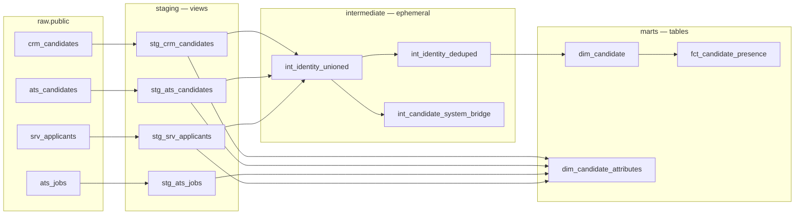

# Jobylon DataForge — Unified Candidate Identity

A dbt project that resolves candidate identity across three separate Jobylon products — CRM, ATS, and Survey — into a single analytics surface.

> [!IMPORTANT]
> **Status: identity resolution is fixed; the attributes table is still being rebuilt. The project has not yet been run against a warehouse.**
>
> Identity is now a minted surrogate over `(customer_id, email)` rather than the per-system `candidate_id`, which resolves the cross-system collision and the cross-tenant merge. `dbt parse` and the unit tests register cleanly, but no model has executed against Snowflake — the `raw` database has not been loaded. Remaining work is tracked under [Remaining](#remaining).

---

## The problem

Each product stores its own candidate records. The same person can appear in all three with different attributes, different completeness, and conflicting values for the same field. There is no shared identity layer, so questions that cross product boundaries can't be answered:

- Which candidates exist in more than one system?
- What share of ATS candidates have also responded to a survey?
- Filter all candidates by department, recruiter, or hiring manager — regardless of which product holds that field.

On top of that, the warehouse is multi-tenant: every customer's data sits in shared tables, and no query may ever leak across tenants. This is enforced structurally, by making `customer_id` part of the identity key — see [below](#identity-resolution-what-the-key-must-be).

## What this builds

A layered dbt project that unions the three systems, resolves field-level conflicts down to one row per candidate, and exposes a small star schema built around a candidate identity hub.



## Layers

| Layer           | Materialization | Responsibility                                                                                    |
| --------------- | --------------- | ------------------------------------------------------------------------------------------------- |
| `staging/`      | view            | One model per source table. Rename, cast, stamp `source_system`. No business logic.               |
| `intermediate/` | ephemeral       | Union the systems, then resolve conflicts. Split into two steps so each is testable in isolation. |
| `marts/`        | table           | The analytics surface. Stable and documented.                                                     |

### Why intermediate is split in two

`int_identity_unioned` does the `UNION ALL` and nothing else, so you can assert that its row count equals the sum of the three staging models. `int_identity_deduped` does only the window-function conflict resolution, so you can assert the identity key is unique there. When something breaks, the failing test tells you which step broke.

### Identity resolution: what the key must be

The assignment's Appendix A declares `candidate_id: int (primary key)` **separately** on `crm_candidates`, `ats_candidates`, and `srv_applicants`. These are three independent surrogate keys in three independent systems. Nothing in the brief makes them a shared identifier, and the brief names **email** as the cross-system common denominator.

The correct identity key is therefore a minted surrogate:

```sql
{{ dbt_utils.generate_surrogate_key([
    'customer_id',
    "coalesce(email, source_system || ':' || source_candidate_id::varchar)"
]) }} AS candidate_sk
```

`customer_id` belongs in the key because the warehouse is multi-tenant: the same email under two customers is two distinct candidate records, not one. Each system's native `candidate_id` is then an *attribute*, preserved per-system in `int_candidate_system_bridge`.

The `coalesce` is load-bearing: `generate_surrogate_key` renders NULL as a literal string, so without a fallback every candidate lacking an email would hash identically and collapse into a single person. Falling back to the native per-system id keeps them distinct. Email arrives already lowercased and trimmed from the staging layer.

Because `customer_id` is an input to the key, a partition can never span tenants. That is what prevents one customer's department and recruiter landing on another customer's hub row — a guarantee the `tenant_filter()` macro cannot provide on its own, since it runs downstream of the dedup.

## Models

| Model                         | Grain                         | Purpose                                                                                                                       |
| ----------------------------- | ----------------------------- | ------------------------------------------------------------------------------------------------------------------------------ |
| `int_identity_unioned`        | candidate × system            | Every appearance of every candidate, un-deduplicated.                                                                         |
| `int_identity_deduped`        | candidate                     | One row per candidate, conflicts resolved, system-presence flags set.                                                         |
| `int_candidate_system_bridge` | candidate × customer × system | Preserves the full mapping the hub collapses, and the home for each system's native `candidate_id`.                           |
| `dim_candidate`               | candidate                     | The identity hub. A thin materialization over the deduped model, so dedup logic can change without breaking downstream contracts. |
| `dim_candidate_attributes`    | candidate × attribute         | Key-value store for extensible attributes.                                                                                    |
| `fct_candidate_presence`      | candidate                     | Pre-aggregated system presence plus a bitmask, for fast overlap analytics.                                                    |

### Conflict resolution: most-recent-non-null

When two systems disagree on a field, the most recent non-null value should win — per field, not per row. A candidate whose ATS record is newer but has no phone number should still keep the phone number from their older CRM record. The intent is expressed with `FIRST_VALUE(... IGNORE NULLS)` windows partitioned by the identity key and ordered by `source_timestamp DESC`.

Each window carries an explicit `ROWS BETWEEN UNBOUNDED PRECEDING AND UNBOUNDED FOLLOWING` frame. This is not decoration: `FIRST_VALUE` defaults to a frame ending at the current row, which — combined with keeping the first row of the same ordering — makes every window see only its own row and stop coalescing entirely. That failure mode is silent, so two tests guard it: a unit test whose newest row is deliberately NULL in fields an older row fills, and `assert_dedup_preserves_non_null`, which asserts on real data that no field is NULL in the hub when any system supplied a value.

`email` and `customer_id` need no windowing, since both are inputs to the key and therefore constant within a partition.

### Extensibility: the attributes table

The brief anticipates 50+ future filterable fields (country, city, brand, …). Adding those as columns on the hub means a schema migration per field. Instead, `dim_candidate_attributes` stores them as rows:

```sql
SELECT candidate_id, attribute_value AS country
FROM dim_candidate_attributes
WHERE attribute_name = 'country'
```

Adding a new attribute becomes an insert, not a migration. The hub stays narrow and fast.

> [!WARNING]
> Two defects make this table unable to do the cross-system filtering it exists for: attribute names are not normalized across systems ([issue 7](#8-the-attribute-namespace-doesnt-line-up)), and `attribute_value` mixes VARIANT arrays with scalars, so the query above returns `["Sweden"]` for survey rows and `"Sweden"` for the rest ([issue 8](#9-attribute_value-mixes-arrays-and-scalars)). It also carries no `customer_id` at all ([issue 6](#7-dim_candidate_attributes-has-no-customer_id)).

### System presence and the bitmask

`fct_candidate_presence` encodes presence as `1=crm, 2=ats, 4=srv`, so overlap questions become integer filters instead of three-way boolean logic — `system_bitmask = 3` is exactly "in CRM and ATS, not in Survey".

These flags are only as trustworthy as the identity key, which is why the surrogate matters: on the per-system `candidate_id` the bitmask reported near-total overlap that was purely an artifact of ID ranges coinciding.

## Tenant isolation

`dim_candidate` and `fct_candidate_presence` carry `customer_id`, and queries are scoped through the `tenant_filter()` macro:

```sql
SELECT * FROM {{ ref('dim_candidate') }}
{{ tenant_filter() }}
```

Set the tenant at run time:

```bash
dbt run --vars '{"tenant_id": 123}'
```

With `tenant_id` unset the macro emits nothing, so unscoped builds and CI runs work normally.

| Pattern                                      | Isolation | Query simplicity | Cross-tenant analytics      | Best for                   |
| -------------------------------------------- | --------- | ---------------- | --------------------------- | -------------------------- |
| **A — `customer_id` column** _(implemented)_ | Medium    | Simple           | Easy                        | Teams getting started      |
| **B — row-level security**                   | Strong    | Simplest         | Possible with elevated role | Snowflake shops            |
| **C — schema per tenant**                    | Strongest | Simple           | Hard                        | Compliance-heavy use cases |

Pattern A is what this project implements. **Pattern B is the production upgrade path**: a Snowflake secure view filters on the session's tenant, so the application never writes the predicate itself and can't forget to.

> [!WARNING]
> `dim_candidate_attributes` still has no `customer_id`, so the macro cannot be applied to it at all — see [issue 7](#7-dim_candidate_attributes-has-no-customer_id). Every other mart is scopeable.
>
> Worth noting why the macro alone was never sufficient: it runs *downstream* of the dedup, so when the partition could span tenants the hub row was already corrupted before any filter ran. The fix belongs in the key, not the filter.

## Testing

**Source level** — `_sources.yml` declares freshness thresholds (warn at 24h, error at 48h) and primary-key tests on all four raw tables.

**Generic** — `email_format` is a reusable custom test applied to any email column.

**Singular** — business rules that don't fit a column test:

| Test                              | Asserts                                                                                  |
| --------------------------------- | ---------------------------------------------------------------------------------------- |
| `assert_no_orphan_candidates`     | Every candidate appears in at least one system.                                          |
| `assert_customer_id_consistency`  | No candidate spans multiple customers. Runs against the **unioned** model — against the deduped model it could never fail. |
| `assert_email_dedup_integrity`    | Within a customer, one email maps to one candidate. Scoped by `customer_id`, since two customers can legitimately share `info@company.com`. |
| `assert_dedup_preserves_non_null` | If any system supplied a value, the hub is not NULL for that field.                      |

**Unit tests** — `_unit_tests.yml` runs fixtures without any warehouse data:

| Unit test                                     | Asserts                                                                    |
| --------------------------------------------- | ---------------------------------------------------------------------------- |
| `dedup_keeps_most_recent_non_null`            | Coalescing reaches across the partition; the newest row's NULLs don't win.  |
| `same_email_different_customers_stay_distinct` | The same address under two customers mints two keys.                       |

## Getting started

**Requirements:** Python 3.9+ and a Snowflake account. The models use Snowflake-specific SQL (`LATERAL FLATTEN`, `variant:path` access), so the adapter is not interchangeable.

**1. Install:**

```bash
python -m venv .venv && source .venv/bin/activate
pip install -r requirements.txt
dbt deps
```

**2. Configure credentials.** `profiles.yml` lives in the project root and reads every value from the environment, so no secrets enter the repo:

```bash
cp .env.example .env      # then fill in account, user, password
set -a && source .env && set +a
dbt debug                 # confirms the connection before you build
```

The account identifier is in Snowsight under **Account → View account details** (format `ORGNAME-ACCOUNTNAME`). Role, warehouse, database, and schema default to what a fresh trial provides.

**3. Build:**

```bash
dbt source freshness      # check raw data recency
dbt build                 # run models + tests in dependency order
dbt docs generate && dbt docs serve
```

Scoped to a single tenant:

```bash
dbt build --vars '{"tenant_id": 123}'
```

## Layout

```
.
├── dbt_project.yml
├── packages.yml                      # dbt_utils, dbt_expectations
├── package-lock.yml                  # pinned package versions (committed)
├── profiles.yml                      # env-var based; safe to commit
├── requirements.txt                  # dbt-core + dbt-snowflake
├── .env.example                      # credential template (copy to .env)
├── macros/
│   ├── tenant_isolation.sql          # tenant_filter() — Pattern A
│   └── dedup_helpers.sql             # reusable dedup patterns
├── models/
│   ├── staging/       _sources.yml + 4 staging models
│   ├── intermediate/  _intermediate.yml + union, dedup, bridge
│   └── marts/         _marts.yml + dim_candidate, attributes, presence
├── tests/
│   ├── generic/       test_email_format.sql
│   └── singular/      3 business-rule assertions
├── analyses/          3 worked example queries
└── snapshots/         dim_candidate_snapshot.sql — SCD Type 2 history
```

## Current status

All models, the source declarations, the tenant macro, and the test suite are written, and `dbt parse` succeeds. The project has **not been run against a warehouse**, and the issues below are outstanding.

Required deliverables still empty (0 bytes):

- **`analyses/`** — the brief lists "add 2–3 example queries" as its own numbered requirement. Three files are scaffolded and none are written: cross-system candidate search, system overlap analysis, and survey responses segmented by ATS.
- **`macros/dedup_helpers.sql`** — the dedup windows are written inline in `int_identity_deduped.sql` and belong here.
- **`snapshots/dim_candidate_snapshot.sql`** — SCD Type 2 history. Should snapshot `dim_candidate`, not the ephemeral intermediate model.

Also missing: any `.yml` for the staging layer, so `stg_*` models carry no tests or documentation.

---

## Fixed

| #   | Issue                                                                        | Resolution                                                                                                       |
| --- | ---------------------------------------------------------------------------- | ------------------------------------------------------------------------------------------------------------------ |
| 1   | `candidate_id` treated as a shared key, colliding unrelated people           | surrogate `candidate_sk` over `(customer_id, email)`; native ids moved to `int_candidate_system_bridge`           |
| 2   | Dedup partition spanned tenants, mixing one customer's attributes into another's row | `customer_id` is an input to the key, so a partition structurally cannot span tenants                     |
| 3   | `assert_customer_id_consistency` could never fail                            | repointed at `int_identity_unioned`, grouped by `candidate_sk`                                                   |
| 4   | Most-recent-non-null windows were dead code                                  | explicit `UNBOUNDED FOLLOWING` frame, guarded by a unit-test fixture and `assert_dedup_preserves_non_null`        |
| —   | `MAX()` over BOOLEAN, which Snowflake rejects                                | `BOOLOR_AGG`                                                                                                     |
| —   | `stg_crm_candidates` missing `ats`, breaking the union                       | `CAST(NULL AS VARCHAR) AS ats`, and explicit casts on the other NULL branches for union type stability            |

> [!NOTE]
> These are correct by construction and by `dbt parse`, **not by execution** — no model has yet run against a warehouse.

## Remaining

### 5. `stg_ats_candidates` does not expose `job_id`

`dim_candidate_attributes` joins on `ac.job_id`, which the staging model consumes internally and drops. The intended fix is to delete that branch rather than plumb the column through: `stg_ats_candidates` already carries `department_name` from its own join, so the re-join is redundant.

### 6. ATS recruiter data is silently dropped

`stg_ats_candidates` carries `recruiters` as an array marked "flatten in the next step", but `int_identity_unioned` hardcodes `NULL AS recruiter` for the ATS branch. The flatten never happens.

### 7. `dim_candidate_attributes` has no `customer_id`

It selects `candidate_id`, `attribute_name`, `attribute_value`, `source_system` and nothing else, so `tenant_filter()` cannot be applied to it and `_marts.yml` does not test for it. The table meant to absorb 50+ future filterable fields is the one mart with no tenant scoping at all.

### 8. The attribute namespace doesn't line up

The CRM and ATS branches emit `attribute_name = 'department_name'`. The survey branch flattens raw JSON keys, emitting `'Department'`, `'Hiring manager'`, `'Recruiter'`. So `WHERE attribute_name = 'department_name'` silently misses every survey row, and `'Department'` misses every CRM and ATS row — the table cannot cross-system filter on even one field.

**Fix:** an explicit key-normalization mapping, ideally a seed or macro, so adding attribute #51 doesn't mean editing SQL.

### 9. `attribute_value` mixes arrays and scalars

`LATERAL FLATTEN(input => tags)` over `{"Department": ["Sales"]}` yields `f.value = ["Sales"]` — a VARIANT array. The CRM and ATS branches emit plain VARCHAR. Unioned, the column becomes VARIANT with inconsistent shapes.

**Fix:** either cast `f.value[0]::VARCHAR`, or flatten twice and emit one row per array element — the latter is better, since a candidate with two recruiters keeps both.

### 10. `assert_email_dedup_integrity` needs tenant scoping

It groups by `email` globally. Two different people at two different customers sharing `info@company.com` is legitimate in a multi-tenant warehouse, and this test reports it as corruption. Group by `(customer_id, email)`.

### 11. `stg_ats_candidates` bypasses `stg_ats_jobs`

It joins `source('raw', 'ats_jobs')` directly while `dim_candidate_attributes` joins `ref('stg_ats_jobs')`. Two paths to the same data means a cleaning rule added to the staging model reaches one consumer and not the other. Point both at `ref()`.

### 12. The `indexes` config is inert on Snowflake

Both `dim_candidate` and `dim_candidate_attributes` declare it; dbt-snowflake ignores it without error. Clustering keys are the Snowflake equivalent. This also removes the only nominal guard on `dim_candidate_attributes`' `(candidate_id, attribute_name)` grain, which both the CRM and ATS branches violate by emitting `department_name` — `dbt_utils.unique_combination_of_columns` would catch it.

---

**dbt 1.12 deprecations:** `freshness` should move under `config:` in `_sources.yml`, and `accepted_values`' `values:` should nest under `arguments:` in `_intermediate.yml`.
