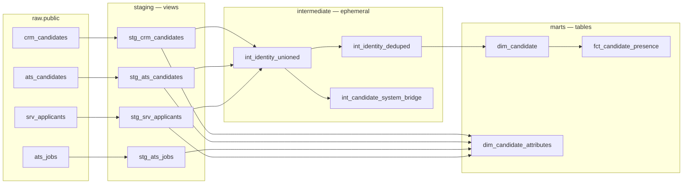

# Jobylon DataForge — Unified Candidate Identity

A dbt project that resolves candidate identity across three separate Jobylon products — CRM, ATS, and Survey — into a single analytics surface.

---

## The problem

Each product stores its own candidate records. The same person can appear in all three with different attributes, different completeness, and conflicting values for the same field. There is no shared identity layer, so questions that cross product boundaries can't be answered:

- Which candidates exist in more than one system?
- What share of ATS candidates have also responded to a survey?
- Filter all candidates by department, recruiter, or hiring manager — regardless of which product holds that field.

On top of that, the warehouse is multi-tenant: every customer's data sits in shared tables, and no query may ever leak across tenants.

## What this builds

A layered dbt project that unions the three systems, resolves field-level conflicts down to one row per candidate, and exposes a small star schema built around a candidate identity hub.



## Layers

| Layer           | Materialization | Responsibility                                                                                    |
| --------------- | --------------- | ------------------------------------------------------------------------------------------------- |
| `staging/`      | view            | One model per source table. Rename, cast, stamp `source_system`. No business logic.               |
| `intermediate/` | ephemeral       | Union the systems, then resolve conflicts. Split into two steps so each is testable in isolation. |
| `marts/`        | table           | The analytics surface. Indexed, stable, documented.                                               |

### Why intermediate is split in two

`int_identity_unioned` does the `UNION ALL` and nothing else, so you can assert that its row count equals the sum of the three staging models. `int_identity_deduped` does only the window-function conflict resolution, so you can assert `candidate_id` is unique there. When something breaks, the failing test tells you which step broke.

## Models

| Model                         | Grain                         | Purpose                                                                                                                                    |
| ----------------------------- | ----------------------------- | ------------------------------------------------------------------------------------------------------------------------------------------ |
| `int_identity_unioned`        | candidate × system            | Every appearance of every candidate, un-deduplicated.                                                                                      |
| `int_identity_deduped`        | candidate                     | One row per candidate, conflicts resolved, system-presence flags set.                                                                      |
| `int_candidate_system_bridge` | candidate × customer × system | Preserves the full mapping the hub collapses — a candidate at a staffing agency may legitimately belong to several customers.              |
| `dim_candidate`               | candidate                     | The identity hub. A thin, indexed materialization over the deduped model, so dedup logic can change without breaking downstream contracts. |
| `dim_candidate_attributes`    | candidate × attribute         | Key-value store for extensible attributes.                                                                                                 |
| `fct_candidate_presence`      | candidate                     | Pre-aggregated system presence plus a bitmask, for fast overlap analytics.                                                                 |

### Conflict resolution: most-recent-non-null

When two systems disagree on a field, the most recent non-null value wins — per field, not per row. A candidate whose ATS record is newer but has no phone number still keeps the phone number from their older CRM record. This is implemented with `FIRST_VALUE(... IGNORE NULLS)` windows partitioned by `candidate_id` and ordered by `source_timestamp DESC`.

### Extensibility: the attributes table

The brief anticipates 50+ future filterable fields (country, city, brand, …). Adding those as columns on the hub means a schema migration per field. Instead, `dim_candidate_attributes` stores them as rows:

```sql
SELECT candidate_id, attribute_value AS country
FROM dim_candidate_attributes
WHERE attribute_name = 'country'
```

Adding a new attribute becomes an insert, not a migration. The hub stays narrow and fast.

### System presence and the bitmask

`fct_candidate_presence` encodes presence as `1=crm, 2=ats, 4=srv`, so overlap questions become integer filters instead of three-way boolean logic — `system_bitmask = 3` is exactly "in CRM and ATS, not in Survey".

## Tenant isolation

Every mart carries `customer_id`, and queries are scoped through the `tenant_filter()` macro:

```sql
SELECT * FROM {{ ref('dim_candidate') }}
{{ tenant_filter() }}
```

Set the tenant at run time:

```bash
dbt run --vars '{"tenant_id": 123}'
```

With `tenant_id` unset the macro emits nothing, so unscoped builds and CI runs work normally.

| Pattern                                      | Isolation | Query simplicity | Cross-tenant analytics      | Best for                   |
| -------------------------------------------- | --------- | ---------------- | --------------------------- | -------------------------- |
| **A — `customer_id` column** _(implemented)_ | Medium    | Simple           | Easy                        | Teams getting started      |
| **B — row-level security**                   | Strong    | Simplest         | Possible with elevated role | Snowflake shops            |
| **C — schema per tenant**                    | Strongest | Simple           | Hard                        | Compliance-heavy use cases |

Pattern A is what this project implements. **Pattern B is the production upgrade path**: a Snowflake secure view filters on the session's tenant, so the application never writes the predicate itself and can't forget to.

## Testing

**Source level** — `_sources.yml` declares freshness thresholds (warn at 24h, error at 48h) and primary-key tests on all four raw tables.

**Generic** — `email_format` is a reusable custom test applied to any email column.

**Singular** — business rules that don't fit a column test:

| Test                             | Asserts                                         |
| -------------------------------- | ----------------------------------------------- |
| `assert_no_orphan_candidates`    | Every candidate appears in at least one system. |
| `assert_customer_id_consistency` | No candidate spans multiple customers.          |
| `assert_email_dedup_integrity`   | One email doesn't map to two candidate IDs.     |

## Getting started

**Requirements:** Python 3.9+ and a Snowflake account. The models use Snowflake-specific SQL (`LATERAL FLATTEN`, `variant:path` access), so the adapter is not interchangeable.

**1. Install:**

```bash
python -m venv .venv && source .venv/bin/activate
pip install -r requirements.txt
dbt deps
```

**2. Configure credentials.** `profiles.yml` lives in the project root and reads every value from the environment, so no secrets enter the repo:

```bash
cp .env.example .env      # then fill in account, user, password
set -a && source .env && set +a
dbt debug                 # confirms the connection before you build
```

The account identifier is in Snowsight under **Account → View account details** (format `ORGNAME-ACCOUNTNAME`). Role, warehouse, database, and schema default to what a fresh trial provides.

**3. Build:**

```bash
dbt source freshness      # check raw data recency
dbt build                 # run models + tests in dependency order
dbt docs generate && dbt docs serve
```

Scoped to a single tenant:

```bash
dbt build --vars '{"tenant_id": 123}'
```

## Layout

```
.
├── dbt_project.yml
├── packages.yml                      # dbt_utils, dbt_expectations
├── package-lock.yml                  # pinned package versions (committed)
├── profiles.yml                      # env-var based; safe to commit
├── requirements.txt                  # dbt-core + dbt-snowflake
├── .env.example                      # credential template (copy to .env)
├── macros/
│   ├── tenant_isolation.sql          # tenant_filter() — Pattern A
│   └── dedup_helpers.sql             # reusable dedup patterns
├── models/
│   ├── staging/       _sources.yml + 4 staging models
│   ├── intermediate/  _intermediate.yml + union, dedup, bridge
│   └── marts/         _marts.yml + dim_candidate, attributes, presence
├── tests/
│   ├── generic/       test_email_format.sql
│   └── singular/      3 business-rule assertions
├── analyses/          3 worked example queries
└── snapshots/         dim_candidate_snapshot.sql — SCD Type 2 history
```

## Current status

All models, the source declarations, the tenant macro, and the full test suite are written. `dbt parse` succeeds. The project has **not yet been run against a warehouse**, and the issues below are outstanding.

Still empty and scaffolded only:

- `macros/dedup_helpers.sql` — the dedup windows are written inline in `int_identity_deduped.sql` and could be factored into a macro here.
- `analyses/` — three worked queries: cross-system candidate search, system overlap analysis, and survey responses segmented by ATS.
- `snapshots/dim_candidate_snapshot.sql` — SCD Type 2 history on the identity hub. Should snapshot `dim_candidate`, not the ephemeral intermediate model.
- No `.yml` for the staging layer, so `stg_*` models carry no tests or documentation.

### Known issues

**Will not compile:**

1. **`stg_crm_candidates` has no `ats` column,** but `int_identity_unioned` selects one from it. The ATS branch handles this with `NULL AS ats`; the CRM branch needs the same.
2. **`stg_ats_candidates` does not expose `job_id`,** but `dim_candidate_attributes` joins on `ac.job_id`. Either select it through, or drop that branch — the ATS staging model already carries `department_name` from its own join, making the re-join redundant.

**Wrong results at run time:**

3. **`MAX()` over a boolean.** `int_identity_deduped` builds the `is_in_*` flags with `MAX(CASE WHEN ... THEN TRUE ELSE FALSE END)`. Snowflake's `MAX` does not accept BOOLEAN — use `BOOLOR_AGG(source_system = 'crm')`.
4. **The dedup windows need an explicit frame.** `FIRST_VALUE(... IGNORE NULLS) OVER (PARTITION BY ... ORDER BY ...)` defaults to `ROWS BETWEEN UNBOUNDED PRECEDING AND CURRENT ROW`. Because the model then keeps `rn = 1` — the first row of that same ordering — each window sees only its own row and the most-recent-non-null coalescing never happens. Add `ROWS BETWEEN UNBOUNDED PRECEDING AND UNBOUNDED FOLLOWING`.
5. **ATS recruiter data is silently dropped.** `stg_ats_candidates` carries `recruiters` as an array marked "flatten in the next step", but `int_identity_unioned` hardcodes `NULL AS recruiter` for the ATS branch. The flatten never happens.
6. **`assert_customer_id_consistency` can never fail.** It groups `int_identity_deduped` by `candidate_id`, which is already unique there, so the distinct count is always 1. It should point at `int_identity_unioned` or the bridge model.

**Config that silently does nothing:**

7. **The `indexes` config is inert on Snowflake.** Both `dim_candidate` and `dim_candidate_attributes` declare it and dbt-snowflake ignores it without error — so the hub is _not_ indexed as described above. Clustering keys are the Snowflake equivalent.
8. **`dim_candidate_attributes` has no enforced grain.** Its dead unique index was the only guard on `(candidate_id, attribute_name)`, and both the CRM and ATS branches emit `attribute_name = 'department_name'`. Duplicates will land undetected; `dbt_utils.unique_combination_of_columns` would catch them.

**Open design question:**

9. **Is `candidate_id` a global identifier?** The union and dedup both assume the same ID means the same person across CRM, ATS, and Survey. If each system mints its own IDs, this collides unrelated people rather than unifying them, and a real identity-resolution step (match on email/phone, mint a surrogate key) is required instead.

**dbt 1.12 deprecations:** `freshness` should move under `config:` in `_sources.yml`, and `accepted_values`' `values:` should nest under `arguments:` in `_intermediate.yml`.
